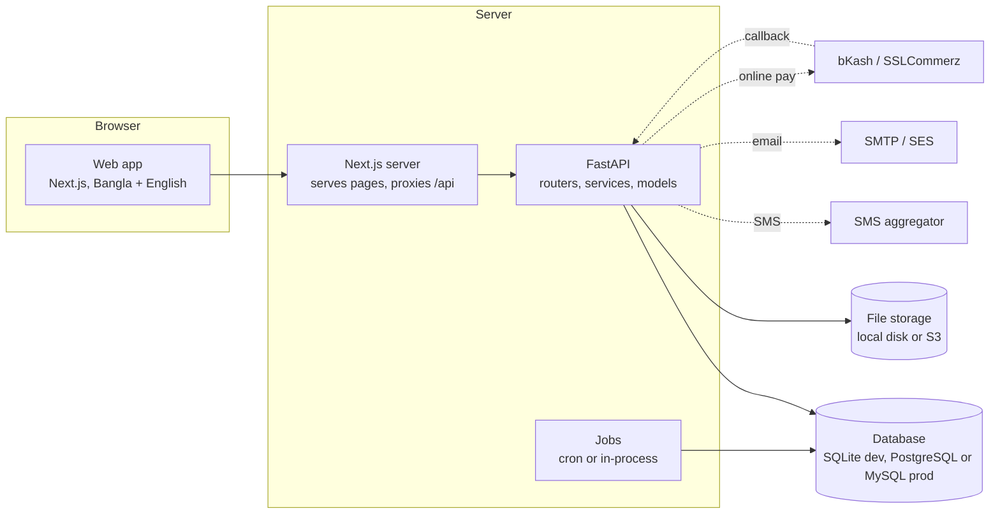
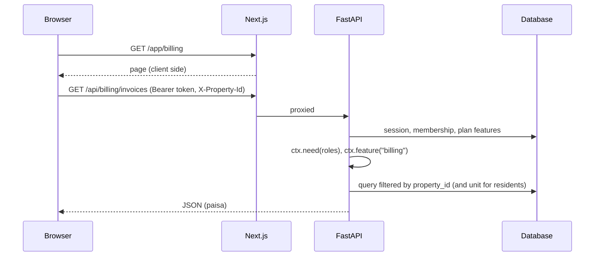

# FlatWise architecture

FlatWise (UPMS) is property and facility management software for buildings in Bangladesh: a FastAPI backend, a Next.js web app, one database. This page is the map. Details live next to the code and in the other documents listed at the end.

## 1. Pieces



| Layer | Where | Notes |
|---|---|---|
| Web app | `frontend/src` | Next.js App Router, TypeScript. `lib/i18n/*.ts` hold every string in English and Bangla; the person sees one language at a time. Tokens and colours are in `app/globals.css`; day and night themes. |
| API | `backend/app` | FastAPI. `routers/` (HTTP), `services/` (rules that more than one router needs), `models/` (SQLAlchemy). |
| Jobs | `backend/app/jobs` | Reminders, invoices, credits, cleanup, integrity check. Scheduling is cron (`python -m app.jobs.cli run-due`) or an in-process loop. See `docs/JOBS.md`. |
| Database | `DATABASE_URL` | SQLite for development and tests. Production schema comes from Alembic only (`backend/MIGRATIONS.md`). |
| Files | `UPLOAD_DIR` or S3 | Tenant documents, visitor and profile photos, agency documents. Private; served through the API. See `docs/STORAGE.md`. |

## 2. Modules

One router file, one model file and one dictionary file per module. A module is switched on for a building by its plan (`feature` in `services/entitlements.py`).

| Module | Router | What it does |
|---|---|---|
| Foundation | `auth`, `account`, `core` | Sign in, sessions, roles, audit log |
| Website | `public` | Plans, leads, signup and trial |
| SaaS console | `saas`, `saas_reports`, `credits` (console), `campaigns`, `jobs`, `privacy` (retention) | Buildings, plans, leads, FlatWise invoices, credit sales, email campaigns, jobs, data retention |
| Property | `property`, `setup` | Flats, owners, tenants, agency portfolio, setup wizard |
| Service charge | `billing`, `cash`, `gateway` | Charge rules, invoices, payments, receipts, dues, reminders, cash with OTP, online payment |
| Finance | `finance`, `budget` | Expenses and approvals, vendors, assets, budget, ledger |
| People | `staff`, `agency`, `contracts`, `onboarding` | Staff and payroll, NID vault, agencies and duty roster, tenant onboarding and police pack |
| Communication | `notices`, `credits` | Notices with read proof, policies, SMS and email credits |
| Building life | `complaints`, `committee`, `visitors`, `parking`, `amenities`, `rental`, `profiles` | Requests with SLA, committee and votes, gate, parking, hall booking, rental records |
| Data | `exports`, `privacy` | CSV and ZIP export, account deletion |

## 3. Multi-tenancy

```mermaid
erDiagram
  ORGANIZATION ||--o{ PROPERTY : owns
  ORGANIZATION ||--o{ MEMBERSHIP : has
  ORGANIZATION ||--o{ SUBSCRIPTION : pays
  USER ||--o{ MEMBERSHIP : holds
  PROPERTY ||--o{ UNIT : contains
  UNIT ||--o{ OCCUPANCY : "owner or tenant"
  UNIT ||--o{ INVOICE : billed
  INVOICE ||--o{ INVOICE_LINE : has
  INVOICE ||--o{ PAYMENT : receives
  PAYMENT }o--|| JOURNAL : "posts one"
  JOURNAL ||--o{ JOURNAL_LINE : balanced
  JOURNAL_LINE }o--|| ACCOUNT : to
  PROPERTY ||--o{ EXPENSE : spends
  EXPENSE }o--|| JOURNAL : "posts when paid"
  PROPERTY ||--o{ ACCOUNT : "chart per building"
  PROPERTY ||--o{ STAFF : employs
  PROPERTY ||--o{ NOTICE : publishes
  PROPERTY ||--o{ SERVICE_REQUEST : receives
  PROPERTY ||--o{ VISIT : logs
  PROPERTY ||--|| SETUP_PROGRESS : "wizard state"
```

- **Organization** is the customer: a committee, or an agency that runs several buildings. **Property** is a building and is what plans are priced on. **Unit** is a flat.
- A **Membership** ties a user to a role in an organization, optionally one building and one flat. One person can hold many (a flat owner who is also the treasurer). Customer roles: AGENCY_MANAGER, PROPERTY_ADMIN, FLAT_OWNER, TENANT, CARETAKER, PRESIDENT, SECRETARY, TREASURER, MEMBER, AUDITOR, GUARD, OWNER_REP. FlatWise staff have `users.saas_role` instead: SUPER_ADMIN, SAAS_ADMIN, SAAS_FINANCE, SAAS_SALES, SAAS_USER.
- **Every building-scoped table has `property_id`**, and every query filters on the building resolved by `deps.property_ctx` from the `X-Property-Id` header. That function checks the caller has a membership in the building's organization (an org-level membership with no building covers all of that organization's buildings) and returns a `Ctx` with the union of the caller's roles, the flats they are linked to and the plan's features. Routers call `ctx.need(*ROLES)` and `ctx.feature("key")`; `permissions.py` holds the role groups so a change is made once.
- A record from another building answers 404, never 403, so ids cannot be probed.
- A resident's `Ctx.unit_ids` limits invoices, payments and requests to their own flat.
- A suspended organization is blocked for everyone except FlatWise staff.

## 4. Money rules

1. Money is an **integer number of paisa** in the database, the API and the code. 100 paisa = 1 BDT. No floats, ever. `per_sqft` charges store paisa per square foot and are rounded once per invoice line.
2. The web app formats with `money()` in `lib/api.ts`: Latin digits and `BDT` in both languages so nobody misreads an amount.
3. CSV exports write decimal taka (`1250.50`) from integers, in columns ending `_bdt` (`services/csvio.bdt`).
4. FlatWise **never holds the building's money**. Residents pay the committee's own bKash, Nagad, bank or gateway merchant account; FlatWise records and reconciles.
5. A payment counts only when it is `verified`: instantly if the treasurer or admin records it, after confirmation if a resident submits it. Online payments are settled by the gateway callback, and the redirect is never trusted (`docs/PAYMENTS_SETUP.md`).
6. A transaction id can be used once per building. An invoice's `paid` is the sum of its verified payments.
7. Expenses above BDT 50,000 need two different approvers; the requester cannot be the only approver. Salary sheets: the preparer cannot approve.
8. Items of BDT 20,000 or more are capitalised as assets; cheaper ones are expensed.

## 5. The ledger

`services/ledger.py` is a small double-entry book per building.

- Each building gets a chart of accounts on first use: cash 1010, bank 1020, bKash and Nagad wallet 1030, fixed assets 1500, amenity deposits held 2010, opening balance equity 3010, income 4010 (service charge), 4020 (hall and amenities), 4090 (other), expenses 5010 to 5090. Income is recognised when a payment is verified (cash basis), so there is no receivables account.
- `post()` takes `(account, debit, credit)` lines, **refuses an unbalanced entry** and is **idempotent per (building, source, source_id)**, so posting the same payment or expense twice does nothing.
- Entries are written by events, never typed: a verified payment (`billing.POST_VERIFY` hook), a paid expense, a bought asset, an amenity deposit, a gateway settlement.
- Rows in `journals` and `journal_lines` are **never edited or deleted**. A mistake is fixed by a reversing entry.
- The trial balance (`GET /api/finance/trial-balance`) lists debit and credit totals per account; the `integrity_check` job verifies every entry balances and that `invoice.paid` equals the sum of verified payments.
- Erasing a person (`services/privacy.anonymise_user`) never touches these rows: they hold flat and numeric user ids, not names.

## 6. Feature gating

`Plan.features` is a list of keys (billing, expenses, notices, reminders, parking, visitor, amenities, gateway, committee, rental_records, and so on; the full list is `ALL_FEATURES` in `services/entitlements.py`). `FeatureOverride` switches one key on or off for one organization. `org_features()` returns the effective set. It is used in three places:

1. the API: `ctx.feature("key")` raises **402** when missing;
2. the web app: `useAuth().feature(key)` hides menu items (`lib/nav.ts`) and shows upgrade messages;
3. the public pricing table, read live from `GET /api/public/plans`.

A trial gets every feature of the chosen plan for 30 days.

## 7. Security in one page

Details are in `docs/RUNBOOK.md` and, if it exists in your checkout, `SECURITY.md`. Passwords are bcrypt; access tokens are short-lived and bound to a session row that can be revoked; refresh tokens rotate and are stored hashed. National ID numbers are encrypted with `NID_KEY` and every reveal is logged. `audit_log` is append-only and hash-chained. Public forms have a honeypot, a signed form token and rate limits. `ENV=production` turns on start-up checks (`prodcheck.py`) and removes `/docs`.

## 8. Request flow



## 9. Where to read next

| Topic | File |
|---|---|
| Every table and column | `docs/DATA_DICTIONARY.md` |
| Every endpoint | `docs/API.md` |
| Running the admin side | `docs/ADMIN_GUIDE.md` |
| Going live | `docs/LAUNCH_CHECKLIST.md`, `docs/CPANEL_DEPLOY.md`, `docs/VPS_DEPLOY.md`, `docs/RUNBOOK.md` |
| Settings | `docs/ENV_VARS.md`, `backend/.env.example` |
| Jobs, SMS, email, payments, storage | `docs/JOBS.md`, `docs/SMS_SETUP.md`, `docs/EMAIL_SETUP.md`, `docs/PAYMENTS_SETUP.md`, `docs/STORAGE.md` |
| Database changes | `backend/MIGRATIONS.md` |
| Product intent | `docs/PRD_v1.1.md` |
